<p align="center">
  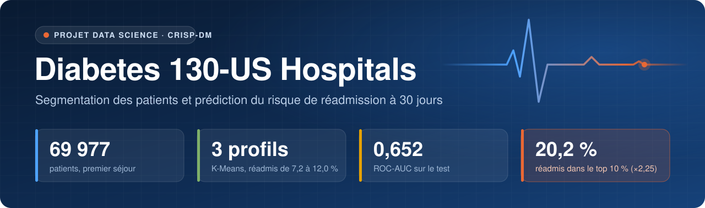
</p>

<p align="center">
  
  
  
  
  
  
</p>

<p align="center">
  <a href="#le-projet-en-bref">En bref</a> ·
  <a href="#objectifs">Objectifs</a> ·
  <a href="#démarche">Démarche</a> ·
  <a href="#les-données">Données</a> ·
  <a href="#segmentation-des-patients-dso-1">Segmentation</a> ·
  <a href="#classification-du-risque-dso-2-et-dso-3">Classification</a> ·
  <a href="#évaluation-sur-le-jeu-de-test">Évaluation</a> ·
  <a href="#relancer-le-notebook">Relancer</a>
</p>

---

## Le projet en bref

Une réadmission à l'hôpital dans les 30 jours qui suivent la sortie coûte cher et signale souvent un suivi insuffisant.
À partir de **101 766 séjours** de patients diabétiques dans **130 hôpitaux américains** (1999-2008), ce projet
répond à deux questions, en suivant la méthodologie **CRISP-DM** :

<table>
  <tr>
    <td width="50%" valign="top">
      <h3>Qui sont les patients ?</h3>
      Une <b>segmentation K-Means</b> regroupe les patients en <b>3 profils</b> selon leur complexité clinique, leur
      recours antérieur aux soins et l'intensité de leur séjour. Le taux de réadmission va de <b>7,2 %</b> à
      <b>12,0 %</b> selon le profil.
    </td>
    <td width="50%" valign="top">
      <h3>Qui faut-il rappeler en priorité ?</h3>
      Un <b>modèle XGBoost</b> attribue à chaque patient, à sa sortie, un score de risque. Les <b>10 %</b> de patients
      aux scores les plus élevés comptent <b>20,2 %</b> de réadmis : <b>2,25 fois</b> plus qu'un tirage au hasard.
    </td>
  </tr>
</table>

Le notebook complet, déjà exécuté, se lit directement sur GitHub :
**[`analysis/notebook_diabetes_dynamika.ipynb`](analysis/notebook_diabetes_dynamika.ipynb)**.

## Objectifs

| | Objectif métier (BO) | Objectif data science (DSO) | Critère de succès | Résultat |
| :-: | --- | --- | --- | :-: |
| **1** | Décrire les profils de patients pour adapter leur suivi | Segmentation K-Means sur 11 variables | profils stables, lisibles, validés par la réadmission | ✅ k = 3, ARI 0,99 |
| **2** | Identifier les patients à suivre en priorité après la sortie | Score de risque de réadmission à 30 jours | ROC-AUC dans la fourchette publiée **0,60 à 0,70** | ✅ **0,652** |
| **3** | Prioriser les 10 % de patients les plus à risque | Qualité de la liste top 10 % des scores | au moins **18 %** de réadmis (base 9,0 %) | ✅ **20,2 %** |

> [!IMPORTANT]
> Les trois objectifs sont atteints sur le **jeu de test**, mis de côté pendant toute la modélisation et lu une seule
> fois. Ses résultats rejoignent ceux de la validation croisée (ROC-AUC 0,650, top 10 % 20,5 %).

## Démarche

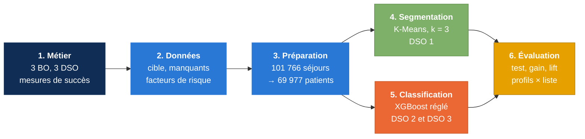

## Les données

Jeu UCI *Diabetes 130-US Hospitals* (Strack et al., 2014) : une ligne par séjour, 50 colonnes (patient, séjour, soins,
recours aux soins l'année précédente, traitement du diabète). La cible `readmitted` est ramenée à une question
binaire : **réadmis dans les 30 jours ou non**.

<p align="center">
  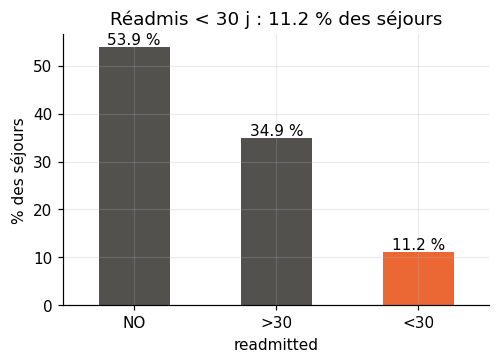
  &nbsp;
  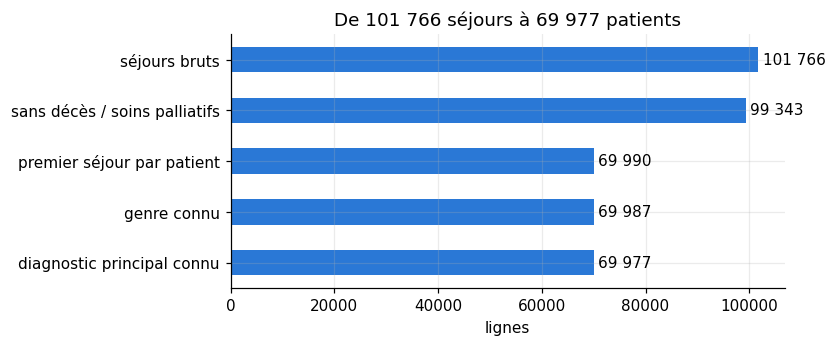
</p>

- **Une classe rare** : 11,2 % des séjours, 8,98 % des patients une fois la cohorte construite. Le déséquilibre est
  traité par des poids de classes, sans SMOTE.
- **Un patient = son premier séjour** : sans cela, les séjours d'une même personne se retrouveraient à la fois en
  apprentissage et en test. Les décès et soins palliatifs sont exclus.
- **Le passé hospitalier pèse lourd** : le taux de réadmission passe de 8,4 % sans hospitalisation l'année précédente
  à 36,4 % à partir de cinq.

<p align="center">
  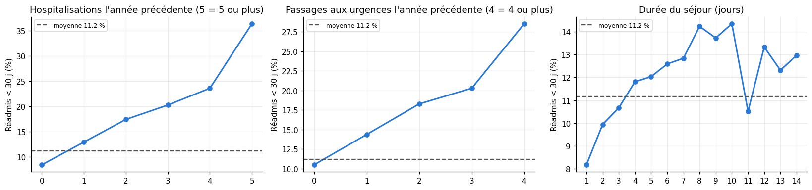
</p>

<details>
<summary><b>Préparation des données, en détail</b></summary>

<br>

| Étape | Décision |
| --- | --- |
| Valeurs manquantes | `weight` (96,9 %) et `payer_code` (39,6 %) supprimées ; `race` et `medical_specialty` → « Inconnu » ; `diag_2`, `diag_3` → « Aucun » |
| HbA1c et glycémie | modalité « Non testé » conservée : l'absence de test renseigne sur le suivi |
| Médicaments | 12 médicaments sur 23 utilisés dans moins de 0,1 % des séjours sont retirés ; les 11 autres gardent leurs 4 modalités |
| Regroupements | admission, sortie, provenance, spécialité (7 niveaux), diagnostics ICD-9 (9 familles, Strack et al.) |
| Variables créées | `total_visits`, `nb_meds_used`, `nb_med_changes` ; l'âge devient un rang de 0 à 9 |
| Variables testées puis écartées | 11 indicateurs, 5 interactions, le profil K-Means : aucun gain au-delà du bruit |

Résultat : **69 977 patients, 35 variables explicatives et la cible**, sans aucune valeur manquante.

</details>

## Segmentation des patients (DSO 1)

Onze variables sur trois axes (**complexité clinique**, **recours antérieur aux soins**, **intensité du séjour**),
transformées en `log1p` quand elles sont asymétriques, puis centrées-réduites. Ni la cible ni le mode de sortie
n'entrent dans la segmentation.

<p align="center">
  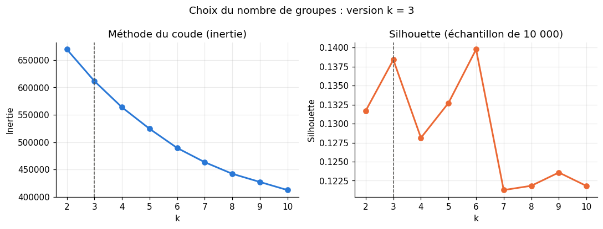
</p>

> [!NOTE]
> **Pourquoi k = 3 ?** Le coude ne casse nulle part et la silhouette reste basse (0,12 à 0,14) : les patients forment un
> continuum. k = 6 a une silhouette à peine plus haute (0,140 contre 0,138) mais il est **instable** (ARI 0,54 entre
> initialisations), alors que k = 3 donne le même découpage à chaque fois (**ARI 0,99**) et reste lisible.

<table>
  <tr>
    <th width="33%">🟦 Profil A : séjours légers</th>
    <th width="33%">🟩 Profil B : séjours lourds</th>
    <th width="33%">🟨 Profil C : passages aux urgences</th>
  </tr>
  <tr>
    <td valign="top"><b>34 198 patients</b> (48,9 %)<br>Séjour court (2 jours), 11 médicaments administrés, 6 diagnostics.<br><br>Réadmis : <b>7,2 %</b></td>
    <td valign="top"><b>30 708 patients</b> (43,9 %)<br>Séjour long (6 jours), 19 médicaments administrés, 9 diagnostics.<br><br>Réadmis : <b>10,5 %</b></td>
    <td valign="top"><b>5 071 patients</b> (7,2 %)<br>1,4 passage aux urgences en moyenne l'année précédente, contre 0,0 ailleurs.<br><br>Réadmis : <b>12,0 %</b></td>
  </tr>
</table>

<p align="center">
  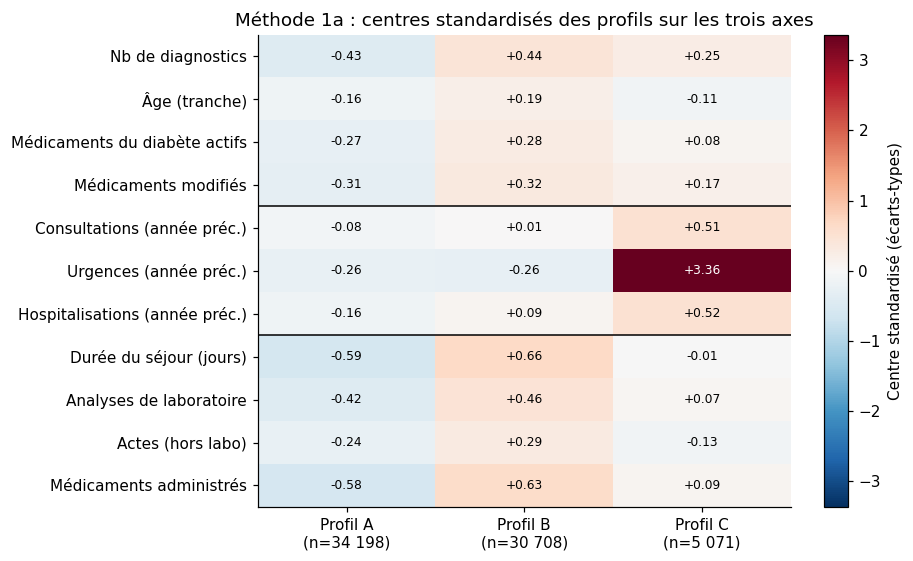
  &nbsp;
  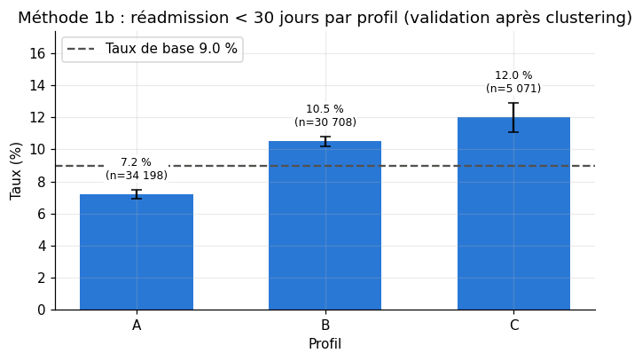
</p>

La projection par ACP montre la même chose : A et B se séparent le long du premier axe (volume de soins), C se détache
sur le troisième (recours aux urgences), mais les nuages se chevauchent, ce que la silhouette faible laissait prévoir.

<p align="center">
  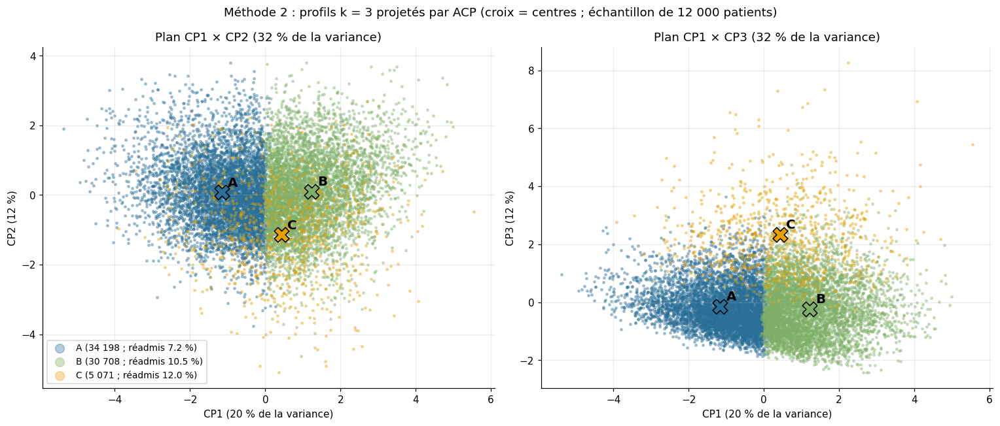
</p>

## Classification du risque (DSO 2 et DSO 3)

Le score est calculé **à la sortie de l'hôpital** : toutes les variables préparées sont utilisées, mode de sortie
compris, mais pas le profil K-Means. Découpage **80 / 20 stratifié** ; le test reste fermé jusqu'à l'évaluation finale.

Trois modèles sont comparés en **validation croisée à 5 plis** :

| Modèle | Réadmis dans le top 10 % | PR-AUC | ROC-AUC |
| --- | :-: | :-: | :-: |
| Régression logistique (poids équilibrés) | 19,3 % | 0,160 | 0,642 |
| **XGBoost réglé** (600 arbres, profondeur 3, taux 0,02) : retenu | 20,5 % | **0,170** | **0,650** |
| XGBoost à arrêt précoce | **20,6 %** | 0,168 | 0,645 |

L'arrêt précoce fait à peine mieux sur le top 10 %, avec un écart plus petit que l'erreur-type : la règle fixée avant le
test retient alors le XGBoost réglé, meilleur en ROC-AUC et en PR-AUC, et plus simple à reproduire (nombre d'arbres
fixe).

<p align="center">
  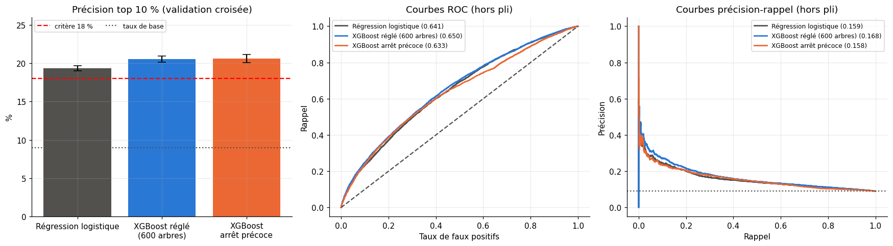
</p>

> [!TIP]
> **Le seuil se déduit de la taille de la liste, pas l'inverse.** Le BO 3 demande une liste de 10 % des patients : le
> seuil retenu est donc **0,618**, celui qui signale 10 % des patients. Le seuil 0,5 n'a pas de sens ici (les poids de
> classes décalent les scores) : il signalerait 36 % des patients.

Les réglages du XGBoost viennent d'une **recherche sur 27 configurations** (nombre d'arbres, profondeur, taux
d'apprentissage). Les meilleures sont à égalité dans la marge d'erreur ; la configuration retenue en fait partie.

## Évaluation sur le jeu de test

<p align="center">
  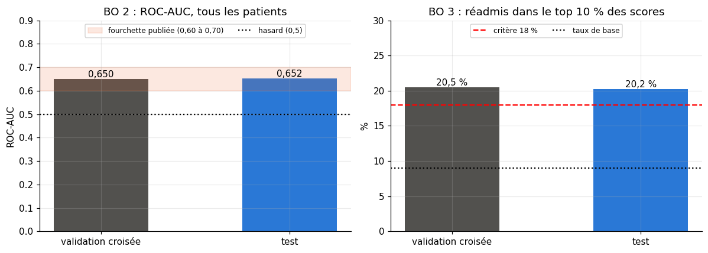
</p>

| | Validation croisée | **Test** |
| --- | :-: | :-: |
| ROC-AUC | 0,650 | **0,652** |
| PR-AUC | 0,170 | **0,174** |
| Réadmis dans le top 10 % | 20,5 % | **20,2 %** |

**Le score classe vraiment les patients**, pas seulement le haut de la liste : le taux de réadmission monte de 3,9 % dans
les 10 % de scores les plus bas à 20,2 % dans les 10 % les plus hauts.

<p align="center">
  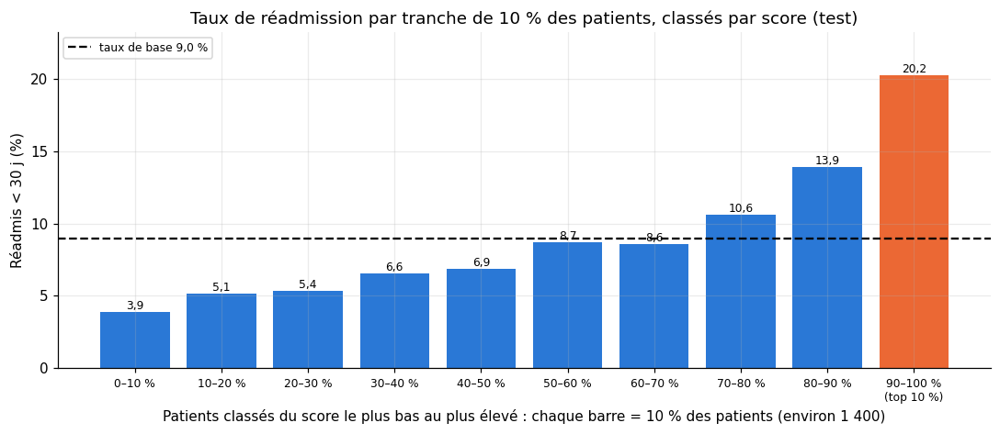
</p>

<p align="center">
  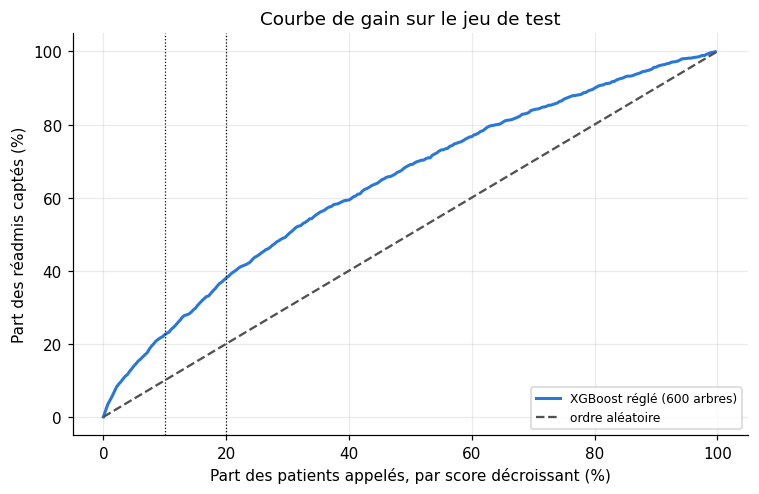
  &nbsp;
  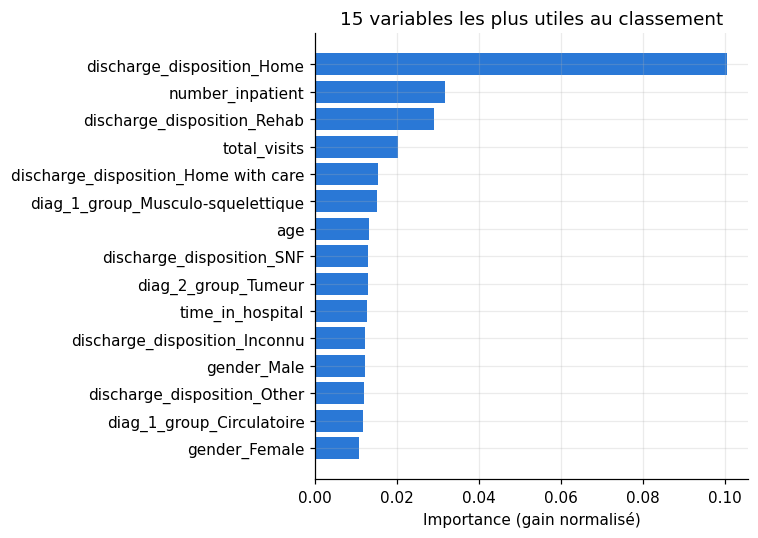
</p>

- **Liste d'appel** : appeler **1 400 patients** (10 %) permet de toucher **22,5 % des réadmis** (lift 2,25) ;
  doubler la liste à 20 % en touche 38,0 %.
- **Principaux facteurs** : le mode de sortie (retour à domicile, rééducation), les hospitalisations de l'année
  précédente et le nombre total de visites. Une importance mesure l'utilité pour le modèle, **pas un effet causal**.

<details>
<summary><b>Matrices de confusion à trois seuils</b></summary>

<br>

<p align="center">
  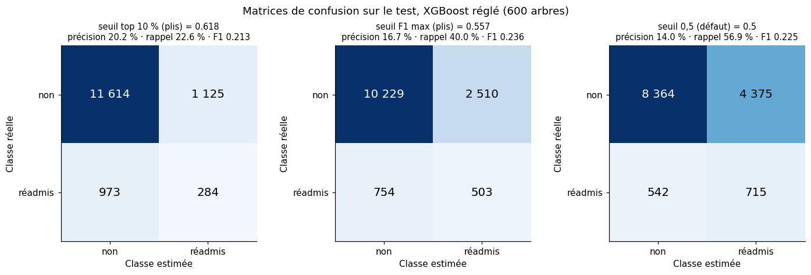
</p>

| Seuil | Patients signalés | Précision | Rappel |
| --- | :-: | :-: | :-: |
| **Top 10 % (0,618)** | 1 409 | **20,2 %** | 22,6 % |
| F1 maximal (0,557) | 3 013 | 16,7 % | 40,0 % |
| 0,5 (par défaut) | 5 090 | 14,0 % | 56,9 % |

Viser plus de rappel coûte cher : 80 % de rappel demande de signaler 64,7 % des patients.

</details>

<details>
<summary><b>Le lien entre les profils et la liste d'appel</b></summary>

<br>

Les profils n'entrent pas dans le modèle, mais la liste top 10 % les retrouve : **23,5 %** des patients du profil C
sont appelés, contre 14,5 % pour B et 3,9 % pour A. En nombre, la liste vient surtout du profil B (63,9 %), le plus
grand des profils à risque.

<p align="center">
  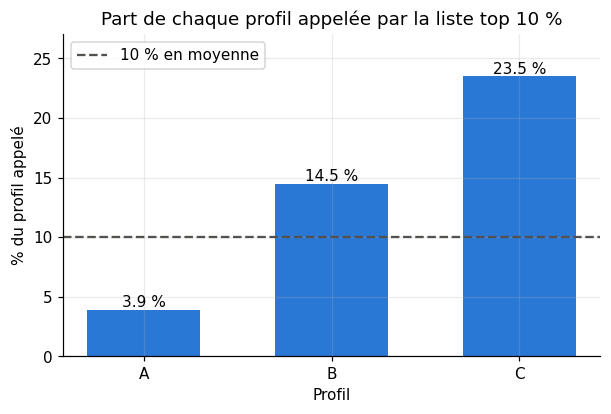
</p>

</details>

<details>
<summary><b>Analyses de robustesse</b></summary>

<br>

- **Mode de sortie** : sans `discharge_disposition`, le top 10 % perd environ 4 points pour tous les modèles. La
  variable est connue au moment du calcul du score, elle est donc gardée.
- **31 autres configurations** (CatBoost, LightGBM, EBM, réseaux de neurones, empilement…) : aucune ne dépasse le
  XGBoost réglé au-delà de l'erreur-type.
- **Tous les séjours au lieu du premier** : la précision monte (26,6 %) parce que le taux de base monte, mais le lift
  bouge peu (2,24 → 2,35).

<p align="center">
  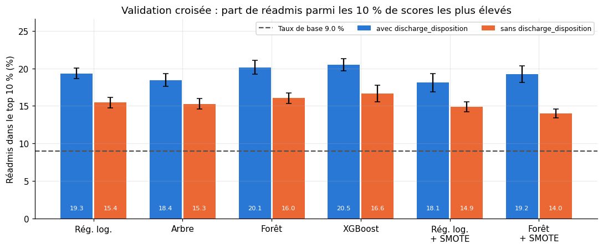
</p>

</details>

## À retenir

> [!WARNING]
> **Le score classe, il ne prédit pas une probabilité.** Une tranche de score moyen 0,69 compte 20,2 % de réadmis,
> pas 69 %. Il sert à ordonner les patients pour le suivi, pas à annoncer un risque individuel.

- La courbe d'apprentissage plafonne vers 0,65 de ROC-AUC : plus de patients aiderait peu. Pour aller plus loin, il
  faudrait d'**autres informations** (suivi après la sortie, contexte social), absentes du jeu de données.
- La segmentation ne sert pas au modèle, mais elle aide à **lire la liste** : on sait de quels types de patients elle
  est faite.

## Relancer le notebook

```bash
pip install -r requirements.txt          # Python 3.12
jupyter nbconvert --to notebook --execute --inplace analysis/notebook_diabetes_dynamika.ipynb
```

Le notebook cherche le dossier `data` en remontant depuis son emplacement :

```text
.
├── data/
│   └── diabetic_data.csv                     obligatoire : jeu UCI n° 296, non redistribué ici
├── analysis/
│   ├── notebook_diabetes_dynamika.ipynb      le notebook final
│   ├── modelisation_resultats.json           section 6.7 (non fourni)
│   ├── modeles_non_conventionnels.json       section 6.8 (non fourni)
│   └── tous_sejours.json                     section 6.9 (non fourni)
├── docs/images/                              figures de ce README, extraites du notebook
└── requirements.txt
```

> [!NOTE]
> Les sections 6.7 à 6.9 redessinent des figures à partir de résultats d'essais enregistrés dans trois fichiers JSON
> qui ne sont pas fournis : sans eux, ces trois cellules échouent, mais leurs sorties restent visibles dans le notebook
> exécuté. Le notebook écrit aussi `diabetes_clean_prepared.csv`, ses figures dans `analysis/figures_modelisation/` et
> un résumé `analysis/notebook_final_k3.json` ; ces sorties ne sont pas versionnées.

## Sources

- **Données** : [UCI Machine Learning Repository, *Diabetes 130-US Hospitals for Years 1999-2008*](https://archive.ics.uci.edu/dataset/296/diabetes+130-us+hospitals+for+years+1999-2008).
- **Article de référence** : Strack B. et al. (2014), *Impact of HbA1c Measurement on Hospital Readmission Rates:
  Analysis of 70,000 Clinical Database Patient Records*, BioMed Research International.

<p align="center">
  <sub>Projet réalisé par <a href="https://github.com/YoussefAbbes">Youssef Abbes</a> · méthodologie CRISP-DM</sub>
</p>
